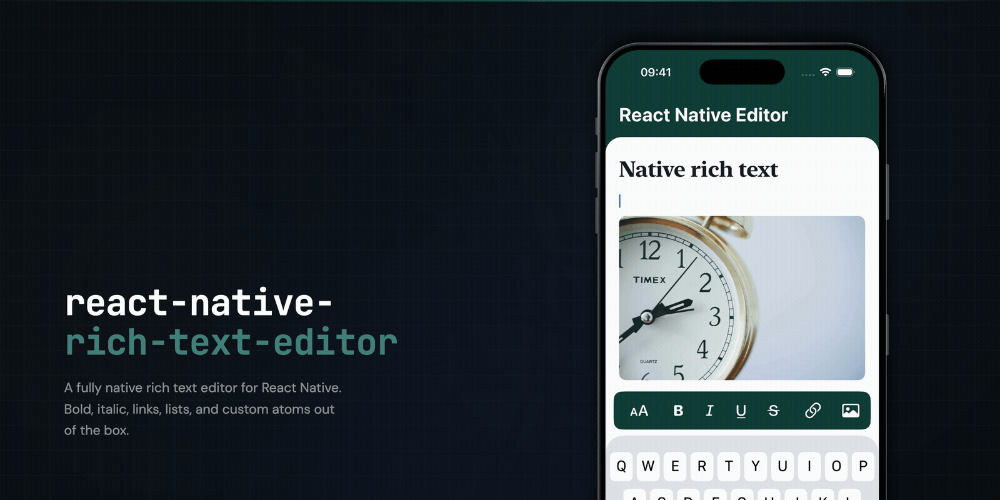

# React Native Rich Text Editor [](https://www.npmjs.com/package/@apollohg/react-native-rich-text-editor)

`@apollohg/react-native-rich-text-editor` is a native rich text editor for React Native. It combines a Rust document core with native iOS and Android editing, a React toolbar and theme API, a Fabric prose viewer, and Yjs collaboration.

See the [documentation](https://github.com/apollohg/react-native-rich-text-editor/wiki) for guides and API references.

<a href="./assets/github-demo-banner.mp4"></a>

## Highlights

**⭐ Native editing on iOS and Android**  
**⭐ Built-in Yjs collaboration**  
**⭐ React Native components inside documents**  
**⭐ External text composition**  
**⭐ Dedicated Fabric viewer**  
**⭐ Configurable document schemas** with HTML and ProseMirror JSON import/export, plus Markdown export<br>
**⭐ Nested bullet and numbered lists**  
**⭐ Optional native code syntax highlighting**  
**⭐ Rich copy and paste**  

## Roadmap

Below is a list of features that are planned or in progress. If you have a feature/idea suggestion, please [add it to the discussion](https://github.com/apollohg/react-native-rich-text-editor/discussions/4).

- [x] External text composition
- [x] Custom atoms via React Native components
- [x] Tables
- [x] Output as Markdown/GitHub Flavored Markdown (GFM)
- [ ] Extension framework
- [ ] Inline node extensions

## Requirements

The package uses custom native code and Expo Modules. Use a development build or a bare React Native app with Expo Modules configured; it does not run in Expo Go.

Requires Expo 52+, React Native 0.76+, React 18+. `RichTextViewer` requires the New Architecture. See the [Installation Guide](https://github.com/apollohg/react-native-rich-text-editor/wiki/Installation) for platform requirements.

## Installation

Install the package:

```sh
npm install @apollohg/react-native-rich-text-editor
```

Add the editor config plugin to an Expo app:

```ts
export default {
    expo: {
        plugins: [
            '@apollohg/react-native-rich-text-editor'
        ],
    },
};
```

Then regenerate and rebuild the native app:

```sh
npx expo prebuild
npx expo run:ios       # or: npx expo run:android
```

See the [Installation Guide](https://github.com/apollohg/react-native-rich-text-editor/wiki/Installation) for bare React Native setup.

## Editor usage

Every editor binds to a `NativeEditorDocumentHandle`. Create the handle once, initialize its content there, and destroy it when its owner unmounts.

```tsx
import React, { useEffect, useMemo } from 'react';
import {
    createNativeEditorDocumentHandle,
    RichTextEditor,
} from '@apollohg/react-native-rich-text-editor';

export function EditorScreen() {
    const documentHandle = useMemo(
        () =>
            createNativeEditorDocumentHandle({
                initialization: {
                    type: 'localHtml',
                    html: '<p>Hello world</p>',
                },
            }),
        []
    );

    useEffect(() => () => documentHandle.destroy(), [documentHandle]);

    return (
        <RichTextEditor
            documentHandle={documentHandle}
            placeholder='Start typing…'
            onContentChange={(html) => console.log(html)}
        />
    );
}
```

See [Getting Started](https://github.com/apollohg/react-native-rich-text-editor/wiki/Getting-Started) and the [RichTextEditor reference](https://github.com/apollohg/react-native-rich-text-editor/wiki/RichTextEditor-Reference) for the complete API.

## Rich text viewer

`RichTextViewer` displays HTML or ProseMirror JSON without creating an editor session. Place it in a container with a finite width:

```tsx
import { RichTextViewer } from '@apollohg/react-native-rich-text-editor';

<RichTextViewer contentHTML='<p>Read-only content</p>' />;
```

See the [Viewer Guide](https://github.com/apollohg/react-native-rich-text-editor/wiki/Viewer) for styling, images, interactions, and custom atoms.

## Comparison with other React Native editors

Reviewed on 7 September 2026

| Editor | Editing surface | Nested lists | Extensions / customization | Collaborative editing | Atoms / embeds | Document format |
| --- | --- | --- | --- | --- | --- | --- |
| **This library** | Native; Fabric via Expo Modules; Rust core | Yes; indent / outdent | Configurable schemas, custom atoms, mentions and highlighting addons | Yjs / Yrs sync and awareness integration | Custom block atoms rendered with React Native components; mentions and images | HTML, ProseMirror JSON |
| [TenTap (`@10play/tentap-editor`)](https://10play.github.io/10tap-editor/docs/mainConcepts) | WebView; Tiptap / ProseMirror | Yes; lift / sink | Bridge extensions and custom Tiptap extensions | Pro example / custom integration | Images; custom Tiptap nodes and atoms in the WebView | HTML, ProseMirror JSON, text |
| [Enriched HTML (`react-native-enriched-html`)](https://github.com/software-mansion/react-native-enriched-html) | Native; Fabric | No; single-level lists | Curated HTML tags, styling and mention configuration | Unsupported | Built-in mentions and images; custom atom types unsupported | HTML, text |
| [Enriched Markdown (`react-native-enriched-markdown`)](https://github.com/software-mansion/enriched-markdown/blob/main/docs/INPUT.md) | Native; Fabric | Yes; bullet / numbered lists | Formatting API, styling and mention configuration | Unsupported | Mentions; custom atom types unsupported | Markdown |
| [Pell (`react-native-pell-rich-editor`)](https://github.com/wxik/react-native-rich-editor) | WebView; HTML `contenteditable` | Browser indent / outdent | Custom toolbar actions; injected JS, DOM and HTML | Unsupported | Images, video and HTML insertion; typed atom API unsupported | HTML |
| [Live Markdown (`@expensify/react-native-live-markdown`)](https://github.com/Expensify/react-native-live-markdown) | Native `TextInput` with live syntax styling | Unsupported | Custom parser worklets over supported formatting types | Unsupported | Mention text styling; custom atom API unsupported | Markdown source (ExpensiMark by default) |

## Development

See the [example app](./example) to try the editor and viewer, and the [Development Workflow](https://github.com/apollohg/react-native-rich-text-editor/wiki/Development-Workflow) for local setup, native builds, and testing.

## Toolbar icons

Default icons are bundled; no icon package or icon config plugin is required. Existing toolbar configuration and default artwork are preserved. Rebuild your native app when upgrading to this version. If Material Design Icons was installed only for the editor, you can remove that dependency and its Expo config plugin.

For React toolbars, pass `renderToolbarIcon` to `RichTextEditor` (with `toolbarPlacement="inline"`) or a standalone `EditorToolbar`. Render any icon component from a package your app chooses:

```tsx
import { Ionicons } from '@react-native-vector-icons/ionicons';
import type { EditorToolbarIconRenderer } from '@apollohg/react-native-rich-text-editor';

const renderToolbarIcon: EditorToolbarIconRenderer = ({ icon, size, color }) => {
    if (icon.type === 'default' && icon.id === 'image') {
        return <Ionicons name="image-outline" size={size} color={color} />;
    }
    return undefined;
};
```

Install and configure your chosen icon library in your app. The callback also receives `isActive`, `isDisabled`, and the resolved button `key` (group children use `groupKey:childKey`). Returning `undefined` preserves the built-in icon; returning `null` hides it. Button layout, accessibility and actions remain managed by the toolbar. The callback applies to group buttons and their menu/expanded children too.

For native keyboard toolbars, use image descriptors in `toolbarItems`. They also work in React toolbars:

```tsx
const imageIcon = {
    type: 'image' as const,
    source: require('./assets/toolbar-image.png'),
    fallbackText: 'Image',
};
```

`source` accepts a bundled asset or `{ uri }` pointing to a local file, data image, or HTTP(S) image, including an image source generated by an icon library. Supply a raster format supported by both platforms. Images follow the button's resolved size and colour; set `tintable: false` to preserve original colours. Failed loads display `fallbackText` (or `?`). Native keyboard toolbars use these serializable descriptors; they do not invoke `renderToolbarIcon`. Their existing SF Symbol and Material defaults remain available.

## Documentation

- [Documentation index](https://github.com/apollohg/react-native-rich-text-editor/wiki)
- [Installation](https://github.com/apollohg/react-native-rich-text-editor/wiki/Installation)
- [Getting started](https://github.com/apollohg/react-native-rich-text-editor/wiki/Getting-Started)
- [Editor API reference](https://github.com/apollohg/react-native-rich-text-editor/wiki/RichTextEditor-Reference)
- [Viewer API reference](https://github.com/apollohg/react-native-rich-text-editor/wiki/RichTextViewer-Reference)
- [Custom atom nodes](https://github.com/apollohg/react-native-rich-text-editor/wiki/Custom-Atom-Nodes)
- [Collaboration](https://github.com/apollohg/react-native-rich-text-editor/wiki/Collaboration)
- [Toolbar setup](https://github.com/apollohg/react-native-rich-text-editor/wiki/Toolbar-Setup)
- [Mentions](https://github.com/apollohg/react-native-rich-text-editor/wiki/Mentions)
- [Styling](https://github.com/apollohg/react-native-rich-text-editor/wiki/Styling)
- [Production limits and errors](https://github.com/apollohg/react-native-rich-text-editor/wiki/Production-Limits-and-Errors)
- [Changelog](./CHANGELOG.md)

## License

[Apache-2.0](./LICENSE). See [third-party notices](./THIRD_PARTY_NOTICES.md) and [Rust standard-library notices](./RUST-STANDARD-LIBRARY-NOTICES.html) for bundled dependencies.
